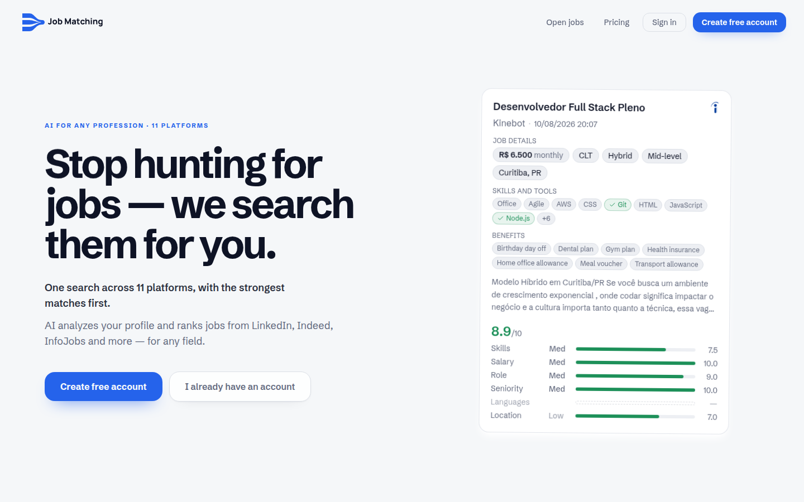
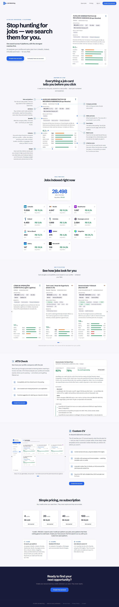
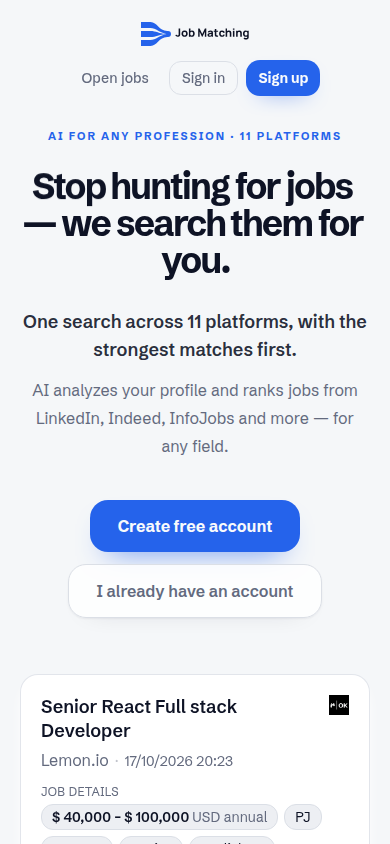
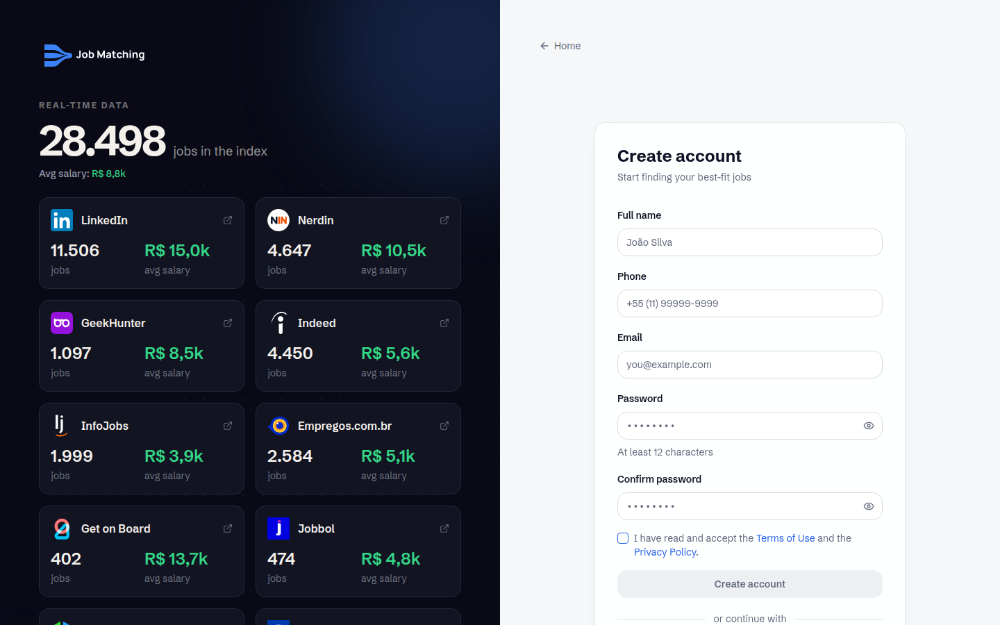
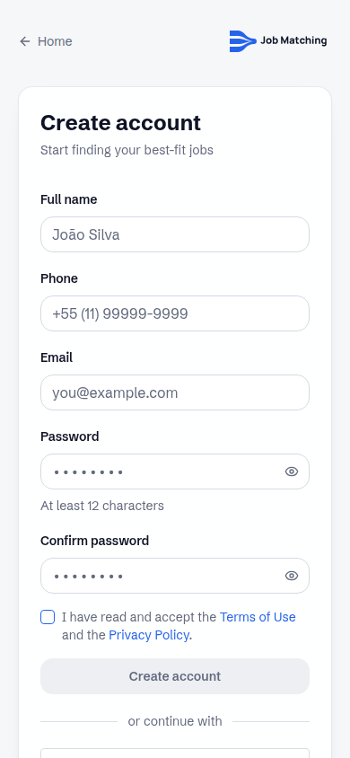

# Job Matching

**One search across 11 job platforms, ranked by how well each posting fits your profile, scored by AI.**

Live: **https://jobmatching.fun** (short alias: https://jobm.fun) - English and Portuguese UI.

> This repository is a showcase only. The product's source code is private (see [Source code](#source-code-is-private)).

## The problem

Looking for a job means checking many boards, each with its own filters, duplicated postings and no real sense of fit. Most of the time goes into opening listings that turn out to be wrong for you: wrong seniority, wrong salary, wrong work mode, wrong stack.

## How it works

1. **Create a free account** (e-mail or Google sign-in).
2. **Build your profile**: import a CV, paste text, or share a LinkedIn profile, or answer a couple of questions. The AI fills the profile fields (roles, skills, seniority, salary range, work mode, contract type, location scope).
3. **Run a search.** The platform searches the job boards you pick in one go.
4. **Every posting is scored** against your profile and shown with a breakdown per criterion (skills, salary, role, seniority, languages, location, work mode, contract...). You can weight the criteria that matter most to you.
5. **Browse and decide**: filter, favourite, comment, open the posting at its source, track what you applied to.
6. **Optionally** run an ATS check (how your CV compares to a posting's required keywords) and generate a tailored CV for a specific job.

## Features

- Aggregation from 11 sources: LinkedIn, Indeed, InfoJobs, Nerdin, GeekHunter, Empregos.com.br, Get on Board, Jobbol, Jobgether, Jobicy, RemoteOK
- AI compatibility score (0-10) with a per-criterion breakdown and user-adjustable weights
- Profile autofill from a CV, free text or a LinkedIn URL
- Job views: My Jobs, All Jobs, Companies, Sources, Favourites, Stats (statistics map and charts), job detail with comments
- Import a posting by its link
- ATS check with required/preferred keyword analysis
- Tailored CV generation with an editor and PDF / DOCX / text export
- Notifications (in-app bell, e-mail), weekly digest
- Shareable public job pages with link previews
- Pay-per-use credits (card, PIX, Mercado Pago balance), a free first search, referral codes
- Real-time progress while a search runs
- Bilingual interface (PT / EN), light and dark themes

## Screenshots

| Desktop (1440x900) | Mobile (390x844) |
|---|---|
|  |  |
|  |  |

Full-length landing: [desktop](docs/screenshots/landing-full-desktop.png) - [mobile](docs/screenshots/landing-full-mobile.png). All captures are of public pages; no account data is shown.

## Links

- Product: https://jobmatching.fun
- Short alias: https://jobm.fun
- Terms of Use: https://jobmatching.fun/en/terms
- Privacy Policy: https://jobmatching.fun/en/privacy

## Source code is private

The source code of Job Matching is not public. For questions, a walkthrough or collaboration, reach out through my GitHub profile: [@SCROLLUCK](https://github.com/SCROLLUCK).
